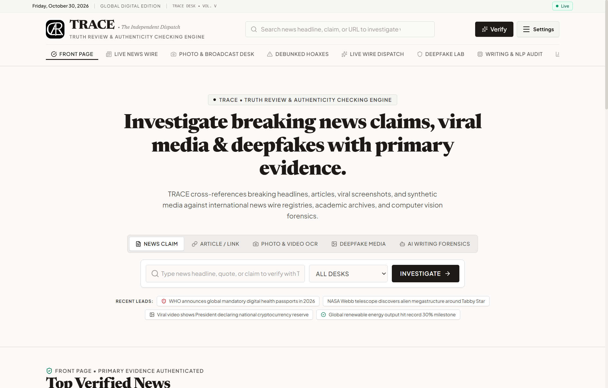
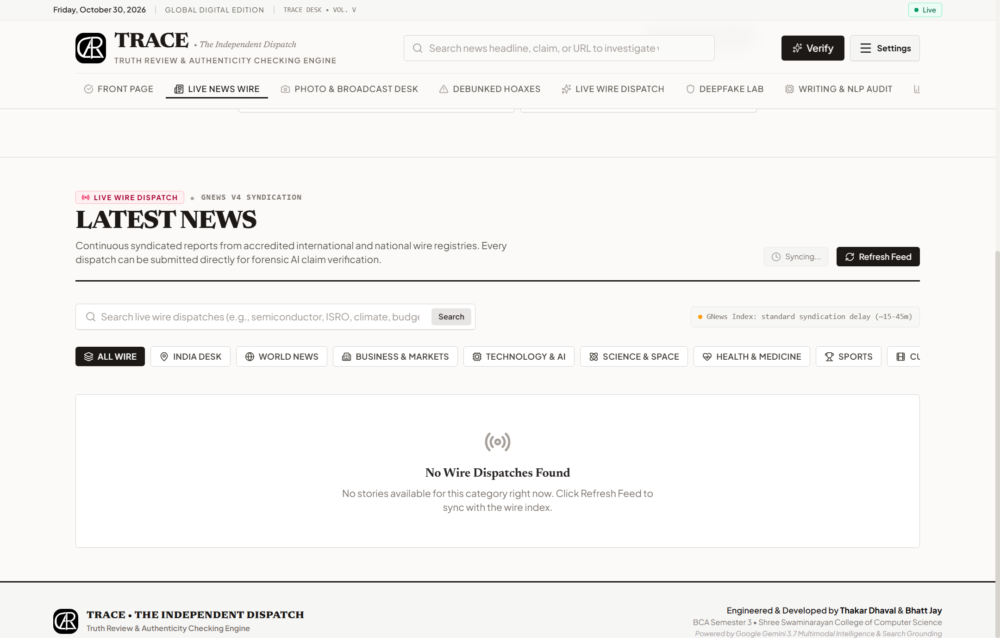
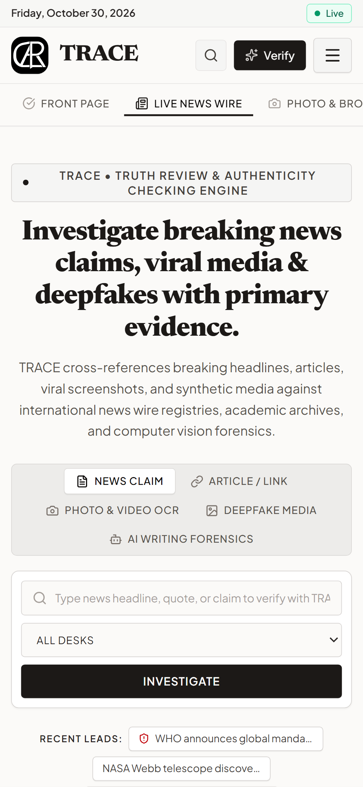
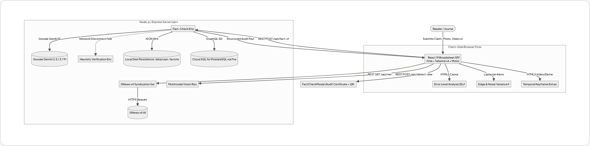
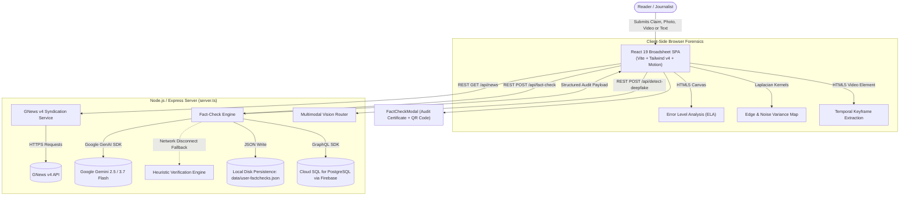

<div align="center">


# TRACE

### Truth Review & Authenticity Checking Engine

*Broadsheet digital journalism, live syndicated news wire, multimodal fact-checking, 4-pillar deepfake detection & NLP authorship forensics.*

<br />


<br />

[**Preview**](#-preview-light-mode) ·
[**Features**](#-features) ·
[**How it works**](#-how-it-works) ·
[**Getting started**](#-getting-started) ·
[**API Reference**](#-api-reference) ·
[**Team**](#-team)

</div>

---

## 📖 About

**TRACE** (**T**ruth **R**eview & **A**uthenticity **C**hecking **E**ngine, formerly TruthLens AI) is an investigative digital newsroom platform designed to combat misinformation, altered broadcast media, and generative synthetic content. 

Engineered with authentic **broadsheet newspaper typography** (featuring *Newsreader*, *Lora*, and crisp hairline borders), TRACE unifies four core journalistic and forensic capabilities into a single cohesive interface:

- 📰 **Live Syndicated News Wire (GNews v4):** Real-time dispatches across 9 categories (India Desk, World, Business, Tech, Science, Health, Sports, Culture) with 5-minute automated updates and 1-click **"Verify This Claim with AI"** direct pipeline integration.
- 🔍 **AI-Grounded Claim Verification:** Dispatches viral headlines and claims to Google Gemini with dynamic Search Grounding, primary source attribution, and 0–100% truth scoring.
- 🖼️ **Multimodal Photo & Broadcast Desk:** Extracts broadcast tickers and newspaper headlines using OCR, checking for doctoring and cross-referencing against primary wire registries.
- 🕵️ **4-Pillar Deepfake Forensic Suite:** Inspects biometric mechanics, digital signal ELA/noise variance, EXIF/C2PA hardware provenance, and video temporal keyframes.
- ✍️ **NLP Authorship & Linguistic Audit:** Measures text token perplexity, sentence burstiness, and predicts potential LLM signatures.
- 🗄️ **Relational PostgreSQL Backend:** Cloud SQL for PostgreSQL via Firebase SQL Connect with durable multi-table schemas.
- 🧾 **Audit Certificates:** Generates formal, printable verification certificates complete with QR codes and accredited source citations.

---

## 📸 Preview (Light Mode)

### 📰 Front Page & Newsroom Investigation Desk
<div align="center">



<sub>The main broadsheet masthead, live dateline, and universal investigation desk: verify claims, URLs, news photos, deepfakes, or text.</sub>

</div>

<br />

### 🌐 Live Wire & Investigative Modules

<table>
  <tr>
    <td width="50%" align="center">
      
      <br /><b>📰 Live News Wire (GNews v4)</b>
      <br /><sub>9-category syndication, search, auto-refresh &amp; 1-click AI verification</sub>
    </td>
    <td width="50%" align="center">
      
      <br /><b>✅ Front Page Verified News</b>
      <br /><sub>High-confidence stories confirmed against primary wire archives</sub>
    </td>
  </tr>
  <tr>
    <td width="50%" align="center">
      
      <br /><b>🕵️ Deepfake Forensic Lab</b>
      <br /><sub>Biometrics, ELA heatmaps, Laplacian noise &amp; C2PA provenance</sub>
    </td>
    <td width="50%" align="center">
      
      <br /><b>📸 Photo &amp; Broadcast Desk</b>
      <br /><sub>Multimodal OCR extraction, ticker inspection &amp; visual integrity</sub>
    </td>
  </tr>
  <tr>
    <td width="50%" align="center">
      
      <br /><b>🧠 NLP Writing &amp; Authorship Audit</b>
      <br /><sub>Perplexity, burstiness, model fingerprint &amp; sentence-level likelihood</sub>
    </td>
    <td width="50%" align="center">
      
      <br /><b>🧾 Verification Audit Certificate</b>
      <br /><sub>Unique certificate ID, QR code, primary evidence &amp; PDF export</sub>
    </td>
  </tr>
  <tr>
    <td width="50%" align="center">
      
      <br /><b>📊 Platform Analytics &amp; Credits</b>
      <br /><sub>Audit counters, category breakdown charts &amp; academic attribution</sub>
    </td>
    <td width="50%" align="center">
      
      <br /><b>📱 Mobile Broadsheet Experience</b>
      <br /><sub>Fully responsive layout with slide-over drawer and touch navigation</sub>
    </td>
  </tr>
</table>

---

## ✨ Features

| | Module | What it does |
|---|---|---|
| 📰 | **Live News Wire (GNews v4)** | Syndicates live headlines across 9 categories (`general`, `nation`, `world`, `business`, `technology`, `science`, `health`, `sports`, `entertainment`) with 5-min caching, keyword search, honest provider timing disclosure, and 1-click **"Verify This Claim with AI"**. |
| 🔎 | **Claim & URL Fact-Checker** | Evaluates news assertions and returns a structured verdict (`VERIFIED_TRUE`, `DEBUNKED_FAKE`, `MISLEADING`, `UNVERIFIED`), a 0–100 truth score, key findings, and accredited citations. |
| 📸 | **Photo & Broadcast Media Verifier** | Multimodal OCR extracts text from broadcast lower-thirds and newspaper clippings, inspecting layout typography and validating veracity against accredited wire registries. |
| 🕵️ | **4-Pillar Deepfake Lab** | Multi-layer forensics (Biometrics, Digital Signal ELA/Noise, Provenance & EXIF/C2PA metadata, Temporal Video Keyframe inspection). |
| 🧠 | **NLP Authorship & AI Text Sentinel** | Scrutinizes text for synthetic generation using mathematical token perplexity and sentence-level burstiness variance. |
| 🚨 | **Debunked Hoaxes & Live Wire Feed** | Curated catalog of refuted disinformation plus chronological filterable claims feed. |
| 🗄️ | **Firebase SQL Connect (PostgreSQL)** | Relational database schema (`users`, `stories`, `story_findings`, `story_sources`, `media_audits`) running on Cloud SQL via Firebase Data Connect. |
| 🛡️ | **Dual-Portal Auth & Anti-Bot Shield** | Frictionless guest reading for public visitors + restricted Editorial CMS with Cloudflare Turnstile human verification. |
| 🧾 | **Formal Audit Certificates** | Every audited claim generates a high-resolution certificate with QR verification code and print-to-PDF formatting. |
| 🌓 | **Broadsheet Themes** | Toggle seamlessly between Newsprint Paper (`#fbfaf8`) and Midnight Charcoal (`#111317`). |

---

## 🧩 How it works

<div align="center">



<sub>High-level system architecture and data-flow pipeline from user input to forensic inspection and audit certificate.</sub>

</div>

<br />



---

## 🧰 Tech Stack

| Layer | Technologies |
|---|---|
| **Front End** | React 19, TypeScript 5.8, Tailwind CSS v4, Motion (`motion/react`), Lucide React |
| **Build & Bundling** | Vite 6 (custom chunk-splitting), esbuild (server CJS bundling) |
| **Back End** | Node.js 20+, Express 4, dotenv |
| **AI & Grounding** | Google Gemini API (`@google/genai`) with Gemini Flash models & Google Search Grounding |
| **News Syndication** | GNews API v4 (`top-headlines` & `search`) with in-memory caching |
| **Database & Auth** | Firebase Authentication (Google OAuth + SCRYPT), Firebase SQL Connect (Cloud SQL PostgreSQL) |
| **Bot Protection** | Cloudflare Turnstile anti-bot verification challenge |
| **Client Forensics** | HTML5 Canvas API (ELA compression deltas, Laplacian 3x3 convolution, video keyframes) |

---

## 🚀 Getting Started

### Prerequisites

- **Node.js 18+** (Node 20 LTS recommended)
- A **Google Gemini API key** from [Google AI Studio](https://aistudio.google.com/app/apikey)
- A **GNews API key** from [GNews.io](https://gnews.io/) (optional; simulated curated wire fallback is included)

### 1. Clone & Install

```bash
git clone https://github.com/<your-username>/trace-ai.git
cd trace-ai
npm install
```

### 2. Configure Environment

Copy the template file to `.env`:

```bash
cp .env.example .env
```

Edit `.env` to include your credentials:

```env
# Google Gemini AI API Key
GEMINI_API_KEY="your_actual_gemini_api_key_here"

# GNews Live News Feed API Key (https://gnews.io/)
GNEWS_API_KEY="your_actual_gnews_api_key_here"

# Application Server
PORT=3000
```

> 💡 **Tip:** You can also enter or test your Gemini API key directly from the in-app **Settings Drawer** (top-right 3-line menu) without touching `.env`.

### 3. Run in Development

```bash
npm run dev
```

Open your browser at **http://localhost:3000**. The server runs Express with Vite middleware, serving both the front-end SPA and the REST API from port `3000`.

### 4. Build & Run for Production

```bash
# Build frontend and bundle server
npm run build

# Start production server
npm start
```

### Available NPM Scripts

| Command | Description |
|---|---|
| `npm run dev` | Starts dev server on port 3000 with hot-module reload |
| `npm run build` | Compiles client assets into `dist/` and bundles `server.ts` into `dist/server.cjs` |
| `npm start` | Executes the compiled production bundle (`dist/server.cjs`) |
| `npm run lint` | Runs type checking across codebase using `tsc --noEmit` |
| `npm run clean` | Cleans up the `dist/` directory |

---

## 🔌 API Reference

| Method | Endpoint | Purpose |
|---|---|---|
| `GET` | `/api/news` | Syndicated news wire filtered by `category`, `country`, `lang`, `max` (5-min cache) |
| `GET` | `/api/news/search` | Search news wire by query keyword `q` |
| `GET` | `/api/news/cache-stats` | In-memory news cache size and active keys |
| `POST` | `/api/news/clear-cache` | Invalidate and purge news wire cache |
| `GET` | `/api/feed` | Retrieves all persisted fact-checks and platform analytics |
| `POST` | `/api/fact-check` | Performs grounded verification on claim or URL `{ claim, url, category }` |
| `POST` | `/api/fact-check-media` | Multimodal OCR and broadcast ticker integrity audit |
| `POST` | `/api/detect-deepfake` | 4-Pillar deepfake forensic analysis for image or video frame |
| `POST` | `/api/analyze-text` | NLP perplexity and burstiness analysis for AI vs. human text |
| `POST` | `/api/verify-api-key` | Live connectivity ping to validate Gemini API key |
| `GET` | `/api/dataconnect/status` | Real-time status of Firebase PostgreSQL connection |
| `POST` | `/api/admin/news` | Publishes editorial article via TRACE CMS (Admin clearance required) |

---

## 📁 Project Structure

```text
trace-ai/
├── server.ts                       # Express backend, Gemini API routes, GNews proxy & storage
├── vite.config.ts                  # Vite 6 config with vendor chunk splitting
├── dataconnect/                    # Firebase SQL Connect (PostgreSQL schema & queries)
│   ├── dataconnect.yaml            # Connector config for Cloud SQL
│   ├── schema/schema.gql           # GraphQL PostgreSQL schema (users, stories, findings, audits)
│   └── connector/                  # Queries and mutations
├── public/
│   ├── favicon.svg                 # TRACE Monogram vector emblem
│   └── favicon-192.png             # Mobile launcher icons
├── assets/
│   ├── logo.svg                    # Vector broadsheet monogram logo
│   └── screenshots/                # Crisp light-mode preview screenshots
│       ├── home.png                # Broadsheet masthead & investigation desk
│       ├── live-news.png           # Live news wire feed (GNews v4)
│       ├── top-news.png            # Front page verified stories
│       ├── news-media-verifier.png # Photo & broadcast OCR verifier
│       ├── deepfake-detector.png   # 4-Pillar deepfake forensic lab
│       ├── ai-text-analyzer.png    # NLP perplexity & burstiness analyzer
│       ├── audit-certificate.png   # Verification Certificate modal with QR code
│       ├── dashboard.png           # Platform analytics & category breakdown
│       └── mobile.png              # Mobile responsive view
├── src/
│   ├── main.tsx                    # React application entry point
│   ├── App.tsx                     # Central state hub, tab routing & modal manager
│   ├── types.ts                    # Shared TypeScript interfaces
│   ├── components/
│   │   ├── Navbar.tsx              # Broadsheet masthead, dateline & portal drawer
│   │   ├── LiveNewsFeed.tsx        # GNews v4 syndicated feed with 1-click verify
│   │   ├── HeroBanner.tsx          # Investigation hero with mode selector & samples
│   │   ├── TopNewsSection.tsx      # Front Page verified stories
│   │   ├── BustedNewsSection.tsx   # Debunked hoaxes desk
│   │   ├── RecentlyCheckedSection.tsx # Filterable chronological claim feed
│   │   ├── NewsMediaFactChecker.tsx# OCR news photo & broadcast frame checker
│   │   ├── DeepfakeDetector.tsx    # 4-Pillar forensic suite (ELA, noise, provenance)
│   │   ├── AITextAnalyzer.tsx      # NLP perplexity & burstiness forensic tool
│   │   ├── DashboardStats.tsx      # Platform analytics, charts & student credits
│   │   ├── FactCheckModal.tsx      # Formal Verification Certificate with QR code
│   │   ├── AdminPortal.tsx         # Editorial CMS & newsroom monitoring
│   │   ├── AuthGateway.tsx         # Dual-portal authentication modal
│   │   ├── HumanVerificationChallenge.tsx # Cloudflare Turnstile anti-bot shield
│   │   ├── ApiKeyModal.tsx         # Google Gemini API key settings modal
│   │   ├── TraceLogo.tsx           # Official TRACE vector monogram component
│   │   └── Footer.tsx              # Colophon & academic credits
│   ├── services/
│   │   └── newsService.ts          # GNews v4 API client with 5-min caching & fallback
│   ├── utils/
│   │   ├── firebase.ts             # Firebase Auth (OAuth, SCRYPT hash)
│   │   ├── forensicVision.ts       # Client-side Canvas ELA, Laplacian noise, keyframes
│   │   └── dataConnectClient.ts    # Firebase SQL Connect PostgreSQL client
│   └── data/mockData.ts            # Baseline state definitions
├── .env.example                    # Environment configuration template
├── package.json                    # Dependencies & npm build scripts
└── tsconfig.json                   # TypeScript configuration
```

---

## 👥 Team & Academic Attribution

Developed as a major academic project by:

| Name | Role | Degree |
|---|---|---|
| **Thakar Dhaval** | Lead Developer | Bachelor of Computer Applications (BCA), Semester 3 |
| **Bhatt Jay** | Lead Developer | Bachelor of Computer Applications (BCA), Semester 3 |

**Institution:** Department of Computer Science, **Shree Swaminarayan College of Computer Science (SSCCS)**

---

<div align="center">

**TRACE — Dedicated to factual journalism and transparency in the digital age.**

⭐ *If you find this project useful, consider giving it a star on GitHub!*

</div>
